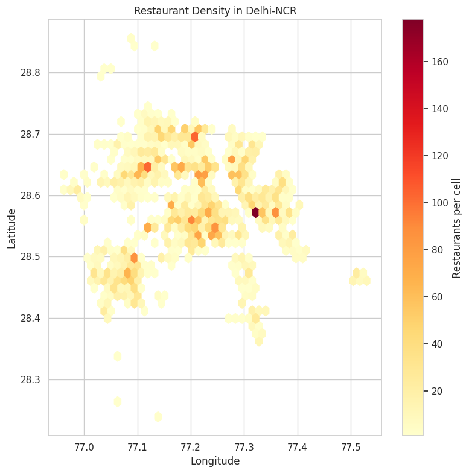
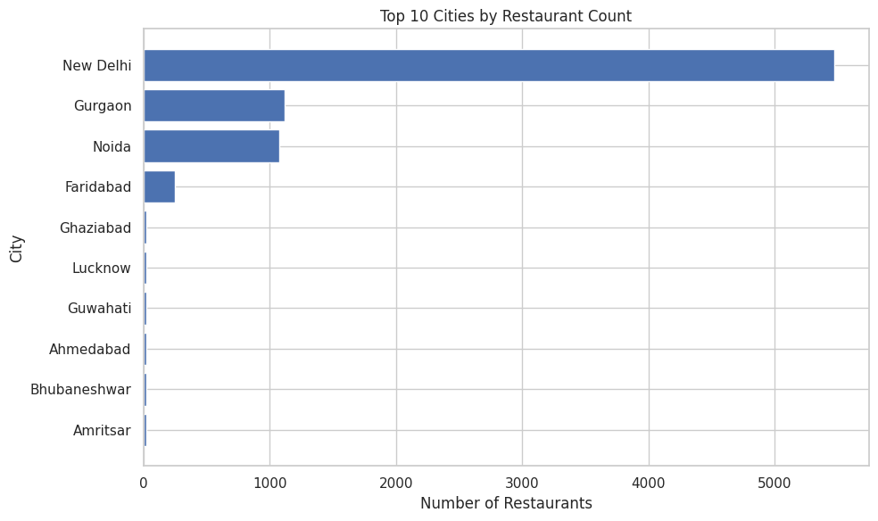
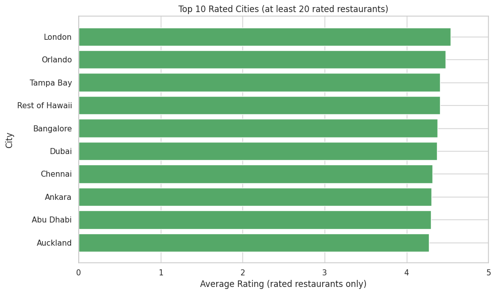
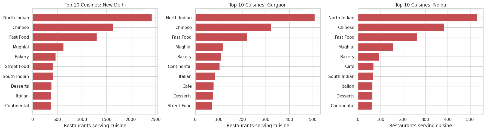
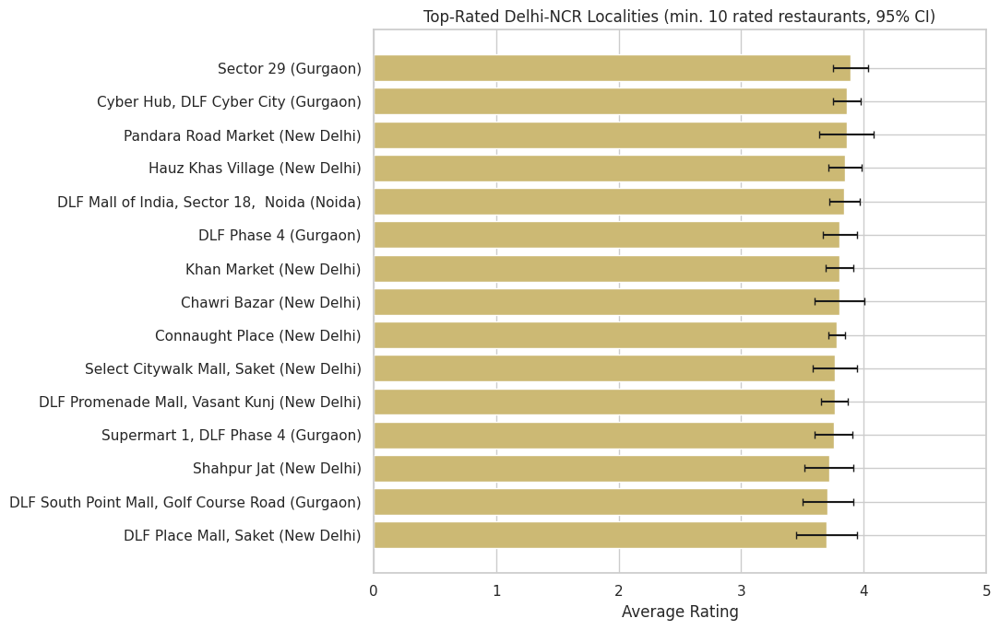
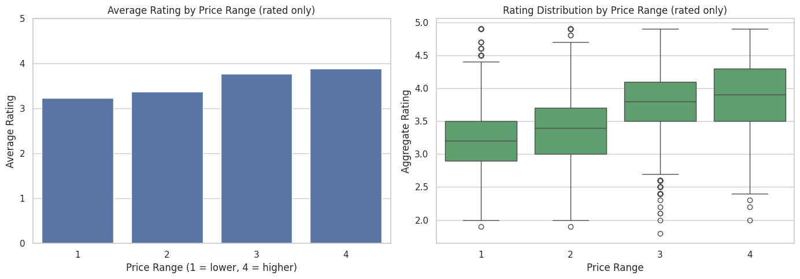

# Cognifyz Task 4 — Location-Based Restaurant Analysis

**Program:** Cognifyz Technologies — Data Science / Machine Learning Internship  
**Author:** Pradeep Srinivas B

## Overview

This project explores the geographical distribution of restaurants and how location relates to cuisine concentration, ratings, and price range. It uses the restaurant dataset with 9,551 records and 21 columns.

## Objectives

- Audit location data and identify missing, invalid, or placeholder coordinates.
- Visualize the global distribution of restaurants.
- Examine restaurant concentration in Delhi-NCR.
- Compare restaurant counts and ratings across cities.
- Identify common cuisines in New Delhi, Gurgaon, and Noida.
- Compare locality-level ratings using minimum sample-size filters.
- Analyze the relationship between price range and restaurant ratings.

## Key Methods

- Data inspection and validation with Pandas and NumPy.
- Global geographical visualization with Plotly.
- Delhi-NCR restaurant-density visualization with Matplotlib.
- City, cuisine, and locality summaries with Pandas.
- Rating distributions and price-range comparisons with Seaborn.
- Pearson and Spearman correlations for price range versus ratings.

## Key Findings

The notebook's results indicate that the dataset is concentrated in Delhi-NCR: New Delhi, Gurgaon, and Noida account for approximately 80.3% of records. North Indian, Chinese, and Fast Food are leading cuisine categories across those major cities. The analysis also finds a positive association between price range and ratings among rated restaurants. These are dataset-specific associations, not evidence that price or location causes a rating.

The notebook identifies placeholder `(0, 0)` coordinates and restaurants with rating `0`; these are treated appropriately for mapping and rating analysis.

## Dataset

The dataset is not included in this repository because redistribution permission has not been confirmed. Before running the notebook, upload the restaurant CSV to the notebook environment. The notebook searches `/content` first and then the current working directory for a `.csv` file.

Use only a dataset you are authorized to access and share. If the notebook finds multiple CSV files, make sure the intended restaurant dataset is the one selected.

## How to Run in Google Colab

1. Open the notebook in Google Colab.
2. Upload the restaurant CSV using the Files panel.
3. Choose **Runtime → Restart session and run all**.
4. Review the outputs and verify that the summary figures match the fresh run.

## Libraries

See [`requirements.txt`](requirements.txt).

## Visual Results

### Restaurant Density in Delhi-NCR

The hexbin plot shows where restaurants cluster within the Delhi-NCR coordinate window. Placeholder coordinates at (0, 0) are excluded from the mapped data.

### City-Level Comparison

Restaurant counts are highly concentrated in a small number of cities, so the dataset should not be interpreted as a balanced global sample.

Only cities with at least 20 rated restaurants are included in this ranking. Smaller groups can produce unstable averages.

### Cuisine Distribution in Major Cities

Multi-cuisine restaurant records are split across cuisine labels, so a single restaurant can contribute to more than one cuisine count.

### Top-Rated Delhi-NCR Localities

Locality comparisons include only groups with at least 10 rated restaurants. The plot includes approximate 95% confidence intervals; results for smaller samples would be less stable.

### Price Range and Ratings

These comparisons use rated restaurants only. They show association between price range and rating rather than a causal effect.

## Limitations

- The dataset is heavily concentrated in Delhi-NCR and does not represent all cities equally.
- Some localities have relatively small samples, so their average ratings are less stable.
- Many restaurants are unrated; they are excluded from rating comparisons.
- The analysis identifies associations, not causal relationships.
- Map and visualization rendering can depend on the notebook environment and network availability.

## Future Work

- Build an interactive city/locality filter dashboard.
- Add interactive Delhi-NCR density maps.
- Model ratings while controlling for cuisine and price range.
- Explore vote-weighted locality comparisons and confidence intervals.

---
Created as an internship analysis project for learning and portfolio demonstration.
